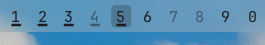

# omarchy-workspaces

An Omarchy bar widget (`zoltanf.workspaces`) that replaces the stock
`omarchy.workspaces`. Built for Omarchy 4.5 with more than one monitor.



- **Numbers stay visible.** Omarchy 4.5 turns the current workspace into a
  filled square. This widget keeps the number and puts a light background
  behind it instead.
- **One highlight per monitor.** Each monitor's bar highlights the workspace
  shown on that monitor, not only the one that has keyboard focus.
- **Underline for this monitor's workspaces.** With more than one monitor, the
  workspaces that belong to the bar's monitor are underlined. An existing
  workspace belongs to the monitor it is on. An empty one belongs to the
  monitor a `monitor = ...` workspace rule would open it on.
- Empty workspaces are dimmed. The highlight is a tint of the theme's text
  color, so it works with light and dark themes.

## Install

```sh
git clone https://github.com/zoltanf/omarchy-workspaces ~/.config/omarchy/plugins/zoltanf.workspaces
```

In `~/.config/omarchy/shell.json`, replace `"id": "omarchy.workspaces"` in the
bar layout with `"id": "zoltanf.workspaces"`, then run `omarchy restart shell`.

## License

MIT, see [LICENSE](LICENSE). The code comes from Omarchy's own workspaces
widget and keeps its MIT notice (© David Heinemeier Hansson,
[LICENSE.omarchy](LICENSE.omarchy)).
